# ⚡ Battery Scope — Monitor Nativo de Batería y Energía para macOS

<p align="center">
  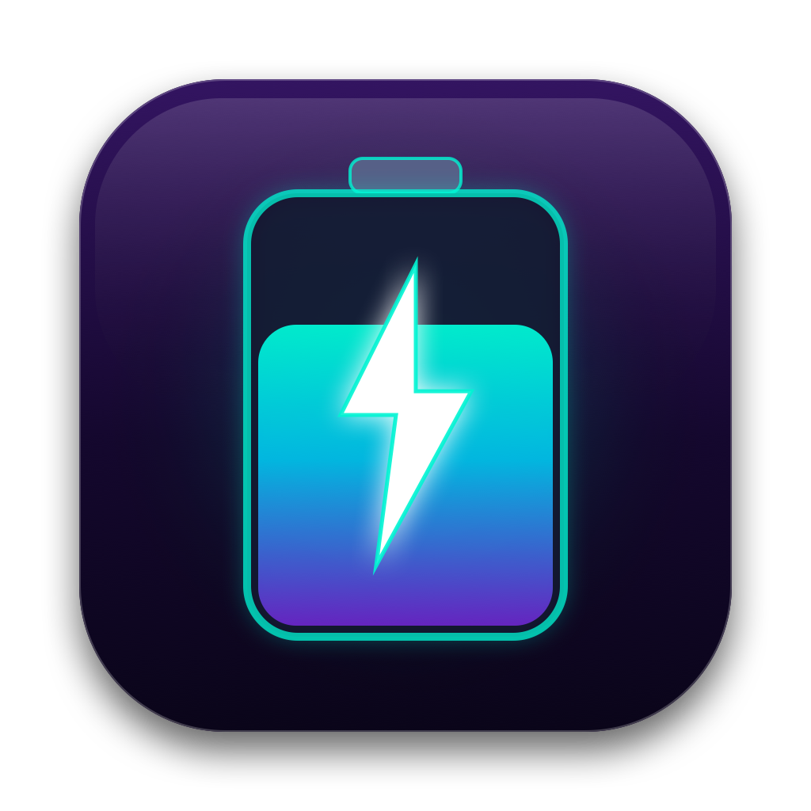
</p>

<p align="center">
  <b>Language / Idioma:</b>
  <a href="README.md"><b>🇺🇸 English</b></a> | 
  <a href="README.es.md"><b>🇪🇸 Español</b></a>
</p>

<p align="center">
  <b>Una suite nativa y elegante de diagnóstico energético y optimización para macOS construida con SwiftUI.</b><br>
  Diseñada especialmente para laptops Mac con procesadores Apple Silicon (M1, M2, M3, M4) e Intel en macOS 13+ (Ventura, Sonoma, Sequoia).
</p>

<p align="center">
  <a href="https://github.com/aldobm/BatteryScope/releases/latest">
    
  </a>
  <a href="https://github.com/aldobm/BatteryScope/releases">
    
  </a>
  
  
  
  
  
  
</p>

---

## 📥 Descarga e Instalación (.DMG)

Descarga directamente el instalador oficial listo para usar:

<p align="center">
  <a href="https://github.com/aldobm/BatteryScope/releases/download/v1.0.0/BatteryScope-v1.0.0.dmg">
    
  </a>
</p>

1. Descarga **[BatteryScope-v1.0.0.dmg](https://github.com/aldobm/BatteryScope/releases/download/v1.0.0/BatteryScope-v1.0.0.dmg)**.
2. Abre el archivo DMG y arrastra **Battery Scope** a tu carpeta de **Aplicaciones**.
3. Abre Battery Scope desde Spotlight, Launchpad o tu carpeta de Aplicaciones.

---

## 📸 Galería y Capturas de Pantalla

### 🌟 Panel de Análisis Inteligente
<p align="center">
  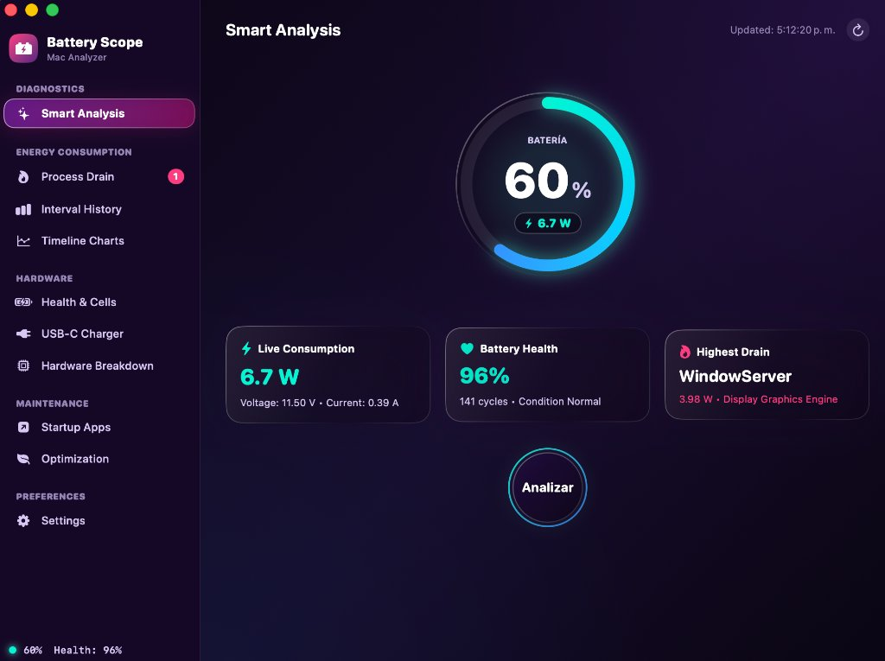
</p>

---

### 🧠 Diagnóstico Inteligente y Recomendaciones Automáticas

A diferencia de los monitores de tareas tradicionales que solo muestran números crudos y PIDs crípticos, Battery Scope **analiza la causa raíz del consumo y te brinda recomendaciones automáticas y prácticas para ahorrar batería**:

<p align="center">
  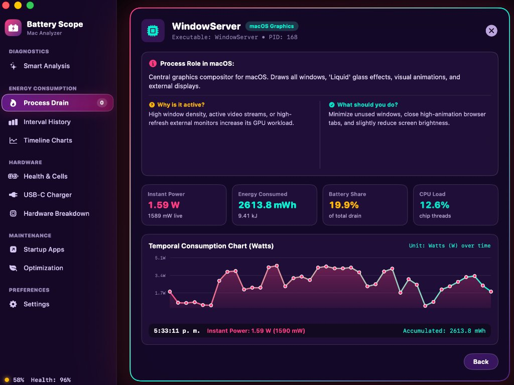
</p>

- ℹ️ **Función del Proceso en macOS:** Explica exactamente qué hace el daemon (`WindowServer`, `fileproviderd`, `siriactionsd`, etc.) en lenguaje claro y accesible.
- ❓ **¿Por qué está activo?:** Diagnostica la causa que disparó el consumo (ej. alta densidad de ventanas, reproducción de video, o pantallas externas).
- 💡 **¿Qué deberías hacer?:** Acciones recomendadas concretas y seguras para reducir el drenaje al instante sin romper el sistema operativo ni cerrar apps bruscamente.
- 📊 **Curva de Consumo Temporal:** Vatios instantáneos, energía total acumulada en mWh, carga de hilos de CPU y porcentaje de cuota sobre la batería.

---

### 🔍 Diagnóstico Energético en Profundidad

| 🔥 Drenaje por Procesos y Telemetría | 📈 Historial por Intervalos y DarkWake |
| :---: | :---: |
| 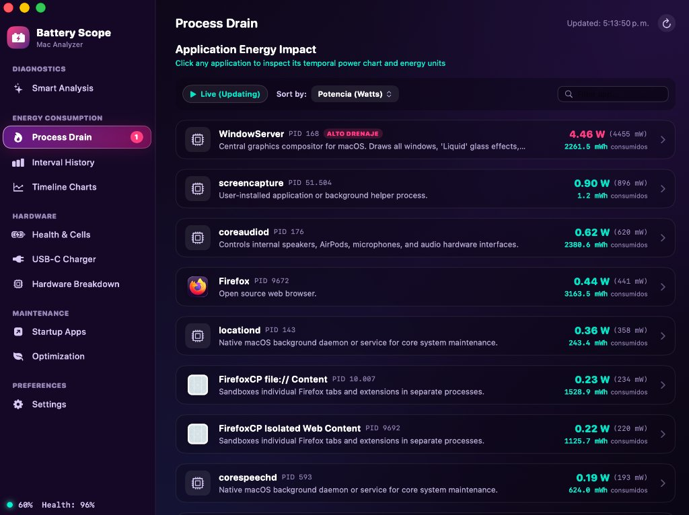 | 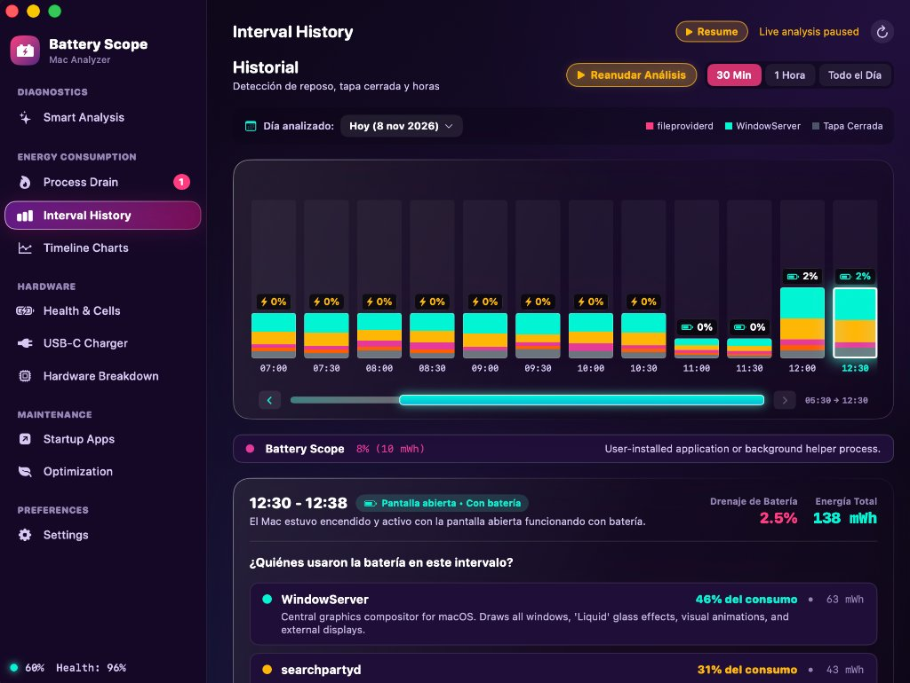 |
| *Consumo acumulado en mWh, vatios en tiempo real y explicaciones de procesos de macOS* | *Telemetría por bloques de 30 minutos y consumos en reposo con tapa cerrada* |

| 📉 Gráficos de Tiempo y Línea de Consumo | 🔋 Salud de Batería y Balance de 3 Celdas |
| :---: | :---: |
| 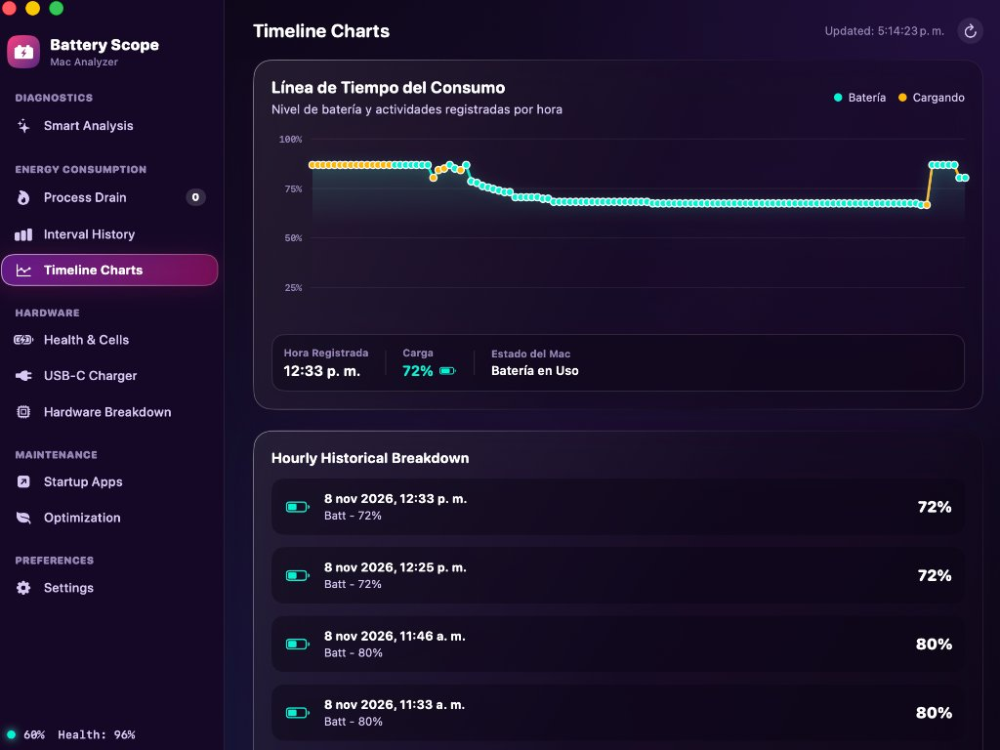 | 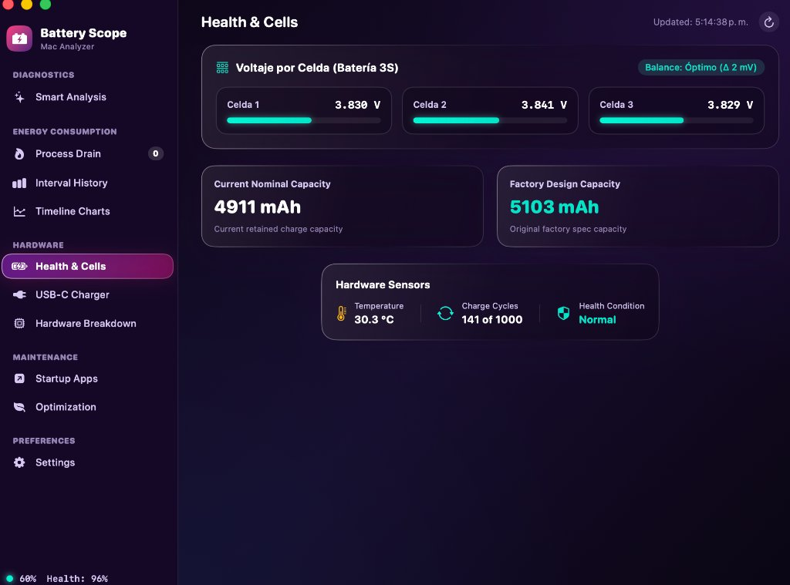 |
| *Curva continua de batería y eventos registrados por hora* | *Voltaje individual de cada celda (3S), capacidad nominal y sensores térmicos* |

---

### 🔌 Inspección de Hardware y Entrega de Energía

| ⚡ Cargador USB-C y Power Delivery | 🖥️ Desglose de Subsistemas de Hardware |
| :---: | :---: |
| 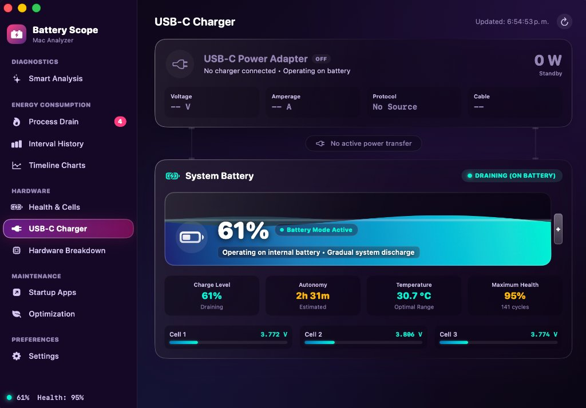 | 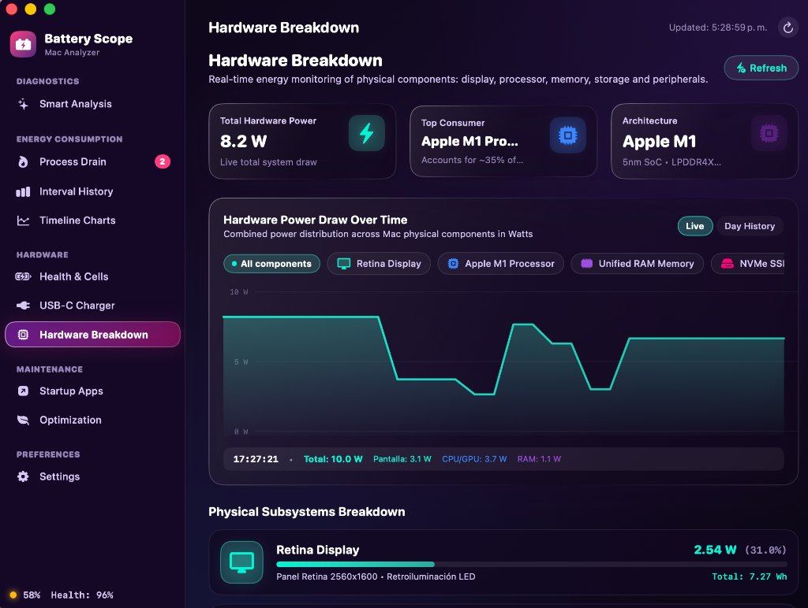 |
| *Potencia PD negociada, voltaje, amperaje y estado del cable* | *Consumo en tiempo real por componente: SoC M1/M2/M3, Pantalla, RAM y SSD* |

---

### 🛠️ Mantenimiento, Inicio y Preferencias

| 🚀 Auditoría de Apps de Arranque | 🛑 Optimización y Congelamiento Inteligente |
| :---: | :---: |
| 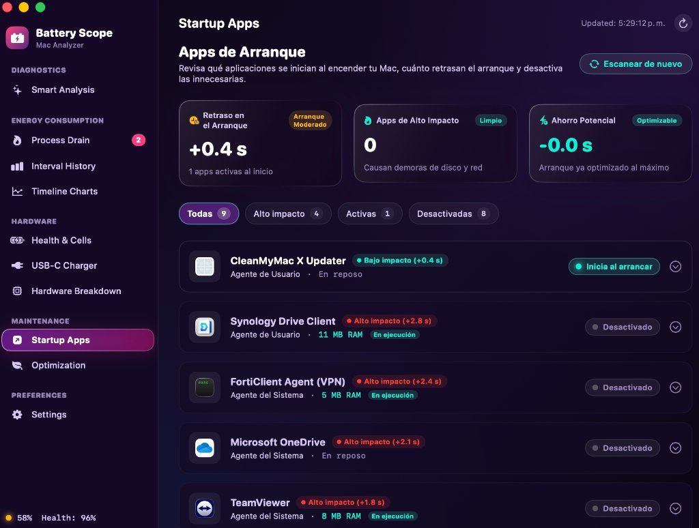 | 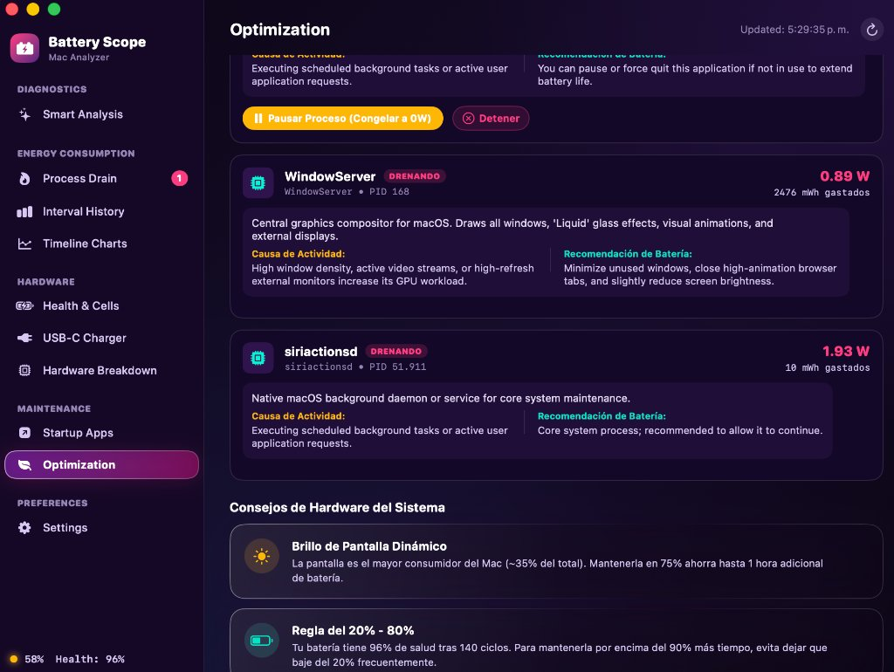 |
| *Control de agentes de inicio de sesión con impacto en el arranque* | *Congela procesos devoradores con SIGSTOP a 0W y consejos dinámicos* |

### 🌐 Ajustes y Selector Multi-idioma
<p align="center">
  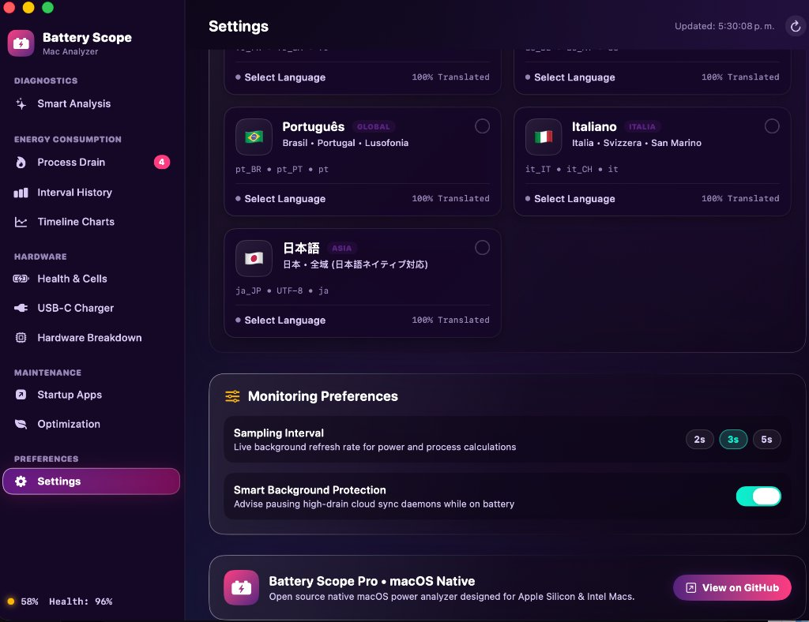
  <br>
  <i>Cambio instantáneo entre 7 idiomas nativos con fichas de banderas interactivas</i>
</p>

---

### 🧭 Menú Emergente en la Barra Superior (Menu Bar)

Battery Scope se integra discretamente en la barra de menús de macOS. Un solo clic despliega el **menú emergente Liquid Glass** para chequear el estado de tu Mac al instante sin interrumpir lo que estés haciendo:

<p align="center">
  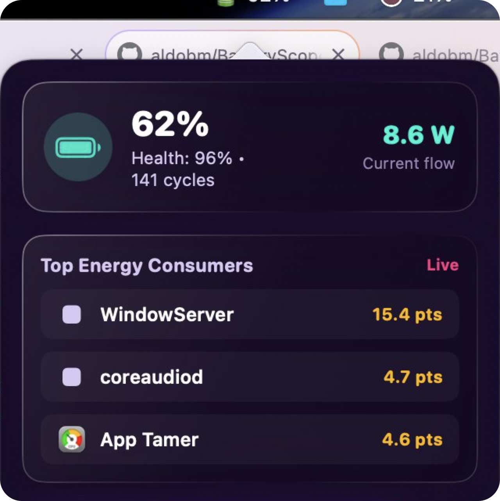
</p>

- ⚡ **Flujo en Vivo y Porcentaje:** Vatios instantáneos de consumo o carga, salud de batería y ciclos.
- 🔥 **Top de Apps Devoradoras en Vivo:** Ranking en tiempo real de los procesos que más consumen en ese segundo.
- 🚀 **Acceso en 1 Clic:** Botón directo para abrir la ventana completa o cerrar la aplicación.

---

## ✨ Características Principales

- **🧠 Diagnóstico Inteligente y Recomendaciones Automáticas**:
  - Base de conocimientos integrada para más de 30 daemons de macOS que responde a *¿Por qué está activo?* y *¿Qué deberías hacer?* con consejos prácticos de ahorro de energía.
- **🔋 Telemetría Inteligente de Batería en Vivo**:
  - Monitoreo en tiempo real de potencia en vatios (W), voltaje (V) y amperaje (A).
  - Balance de voltaje individual de las 3 celdas de la batería.
  - Conteo de ciclos, capacidad nominal retenida y condición de salud.
- **⚡ Inspector de Cargador USB-C y Power Delivery**:
  - Detección de perfil PD negociado, potencia del cargador, voltaje y estado del cable.
- **📊 Historial de Consumo por Intervalos**:
  - Gráfico de barras por bloques de 30 minutos o 1 hora.
  - Detección de consumos en suspensión (*DarkWake*) con la tapa cerrada.
- **🔥 Drenaje por Procesos y Aplicaciones Voraces**:
  - Clasificación de aplicaciones por cuota de consumo, hilos de CPU y milivatios (mW).
  - Curva de consumo temporal por proceso individual.
- **🛑 Control Inteligente de Procesos (Pausar / Reanudar)**:
  - Pausa temporalmente procesos pesados en segundo plano (`Google Drive`, `Synology Drive`, `fileproviderd`) mediante señales Unix (`SIGSTOP`/`SIGCONT`) sin cerrarlos ni perder tu trabajo.
- **🚀 Auditoría de Apps de Arranque**:
  - Revisa elementos de inicio de sesión (*Login Items*) y agentes en segundo plano con control rápido.
- **🖥️ Desglose Energético del Hardware**:
  - Distribución de energía por componentes físicos: Pantalla Retina, Chip Apple Silicon, Memoria RAM Unificada, Almacenamiento NVMe SSD y Audio.
- **🌐 7 Idiomas Nativos Integrados**:
  - 🇺🇸 English
  - 🇪🇸 Español *(predeterminado desde configuración)*
  - 🇫🇷 Français
  - 🇩🇪 Deutsch
  - 🇧🇷 Português
  - 🇮🇹 Italiano
  - 🇯🇵 日本語
  - Cambio instantáneo en caliente desde la sección de Preferencias/Opciones sin reiniciar la app.
- **🧭 Diseño Apple Liquid Glass**:
  - Interfaz moderna en modo oscuro con transparencias satinadas, efectos visuales y acceso rápido desde la barra de menú.

---

## 🛠️ Requisitos del Sistema

- **Equipos Mac**: MacBook Air, MacBook Pro, Mac mini, Mac Studio, iMac o Mac Pro.
- **Procesador**: Apple Silicon (M1, M2, M3, M4) o Intel Core (x86_64).
- **Sistema Operativo**: macOS 13.0 (Ventura), macOS 14.0 (Sonoma) o macOS 15.0+ (Sequoia).

---

## 🚀 Compilar desde el Código Fuente

Si deseas compilar la aplicación tú mismo con las herramientas de línea de comandos de Xcode:

```bash
git clone https://github.com/aldobm/BatteryScope.git
cd BatteryScope
chmod +x build.sh
./build.sh
```

La aplicación se compilará, firmará e instalará automáticamente en:
```
~/Applications/BatteryScope.app
```

---

## 📂 Arquitectura del Proyecto

```
BatteryScope/
├── AppIcon.icns                # Icono nativo de macOS
├── AppIcon.png                 # Imagen de icono para GitHub
├── build.sh                    # Script de compilación y empaquetado
├── create_dmg.sh               # Generador del instalador DMG
├── publish_release.sh          # Publicador automático de Releases en GitHub
├── .github/workflows/          # Flujo de CI/CD para GitHub Actions
├── docs/screenshots/           # Capturas de pantalla e imágenes
├── README.md                   # Documentación en Inglés
├── README.es.md                # Documentación en Español
└── src/
    ├── main.swift              # Punto de entrada de la aplicación
    ├── AppDelegate.swift       # Controlador de ciclo de vida y barra de menús
    ├── MainView.swift          # Ventana principal y pestañas de navegación
    ├── MenuBarView.swift       # Menú emergente de la barra superior
    ├── BatteryService.swift    # Servicio IOKit e IOPS para telemetría
    ├── ProcessDatabase.swift   # Base de datos y explicaciones de procesos
    ├── LocalizationManager.swift # Gestor reactivo de los 7 idiomas
    ├── SettingsView.swift      # Vista de ajustes y selector de idioma
    ├── HardwareBreakdownService.swift # Modelo de distribución de hardware
    ├── HardwareBreakdownView.swift    # Interfaz de desgaste de hardware
    ├── StartupAppsService.swift       # Analizador de apps al inicio
    ├── StartupAppsView.swift          # Interfaz de control de apps de arranque
    ├── TimelineAndEnergyViews.swift   # Gráficos de tiempo e historial de drenaje
    ├── SmartSyncAdvisor.swift         # Optimizador inteligente de sincronización
    ├── LiquidTheme.swift              # Paleta de colores y temas Liquid
    └── LiquidComponents.swift         # Componentes reutilizables SwiftUI
```

---

## 📄 Licencia

Este proyecto está distribuido bajo la licencia MIT — consulta el archivo [LICENSE](LICENSE) para más detalles.
