# ⚡ Battery Scope — macOS Native Battery & Power Analyzer

<p align="center">
  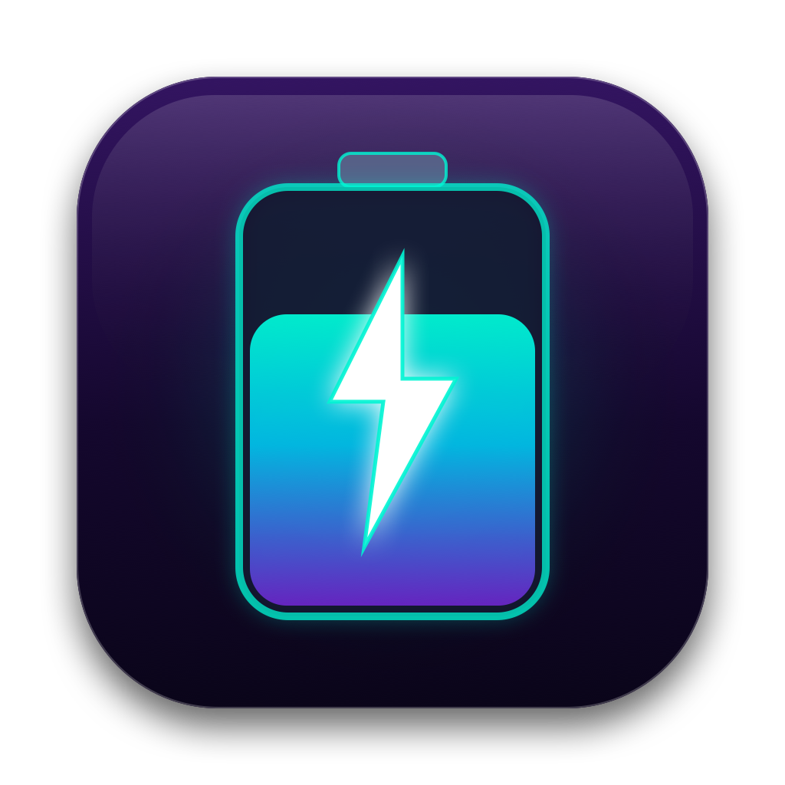
</p>

<p align="center">
  <b>Language / Idioma:</b>
  <a href="README.md"><b>🇺🇸 English</b></a> | 
  <a href="README.es.md"><b>🇪🇸 Español</b></a>
</p>

<p align="center">
  <b>A sleek, native macOS power diagnostic and energy optimization suite built in SwiftUI.</b><br>
  Engineered for Apple Silicon (M1, M2, M3, M4) and Intel Mac laptops running macOS 13+ (Ventura, Sonoma, Sequoia).
</p>

<p align="center">
  <a href="https://github.com/aldobm/BatteryScope/releases/latest">
    
  </a>
  <a href="https://github.com/aldobm/BatteryScope/releases">
    
  </a>
  
  
  
  
  
  
</p>

---

## 📥 Download & Install (DMG)

Download the ready-to-run native installer directly:

<p align="center">
  <a href="https://github.com/aldobm/BatteryScope/releases/download/v1.0.0/BatteryScope-v1.0.0.dmg">
    
  </a>
</p>

1. Download **[BatteryScope-v1.0.0.dmg](https://github.com/aldobm/BatteryScope/releases/download/v1.0.0/BatteryScope-v1.0.0.dmg)**.
2. Double-click the DMG and drag **Battery Scope** into your **Applications** folder.
3. Launch from Launchpad, Finder, or Spotlight.

---

## 📸 Interface & Feature Showcase

### 🌟 Smart Analysis Dashboard
<p align="center">
  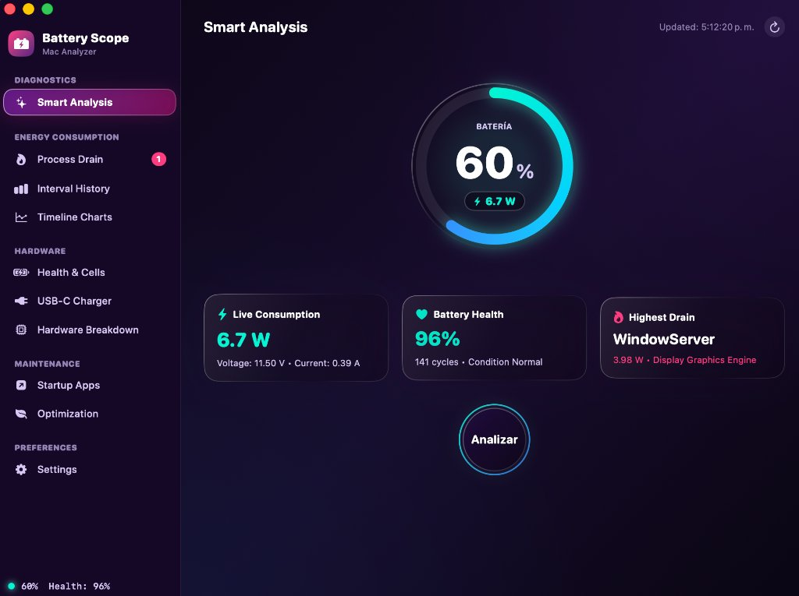
</p>

---

### 🧠 Automated Intelligent Recommendations & Process Inspector

Unlike standard task managers that just show cryptic numbers and PIDs, Battery Scope actively **analyzes the root cause of energy drain and gives you automated, actionable recommendations**:

<p align="center">
  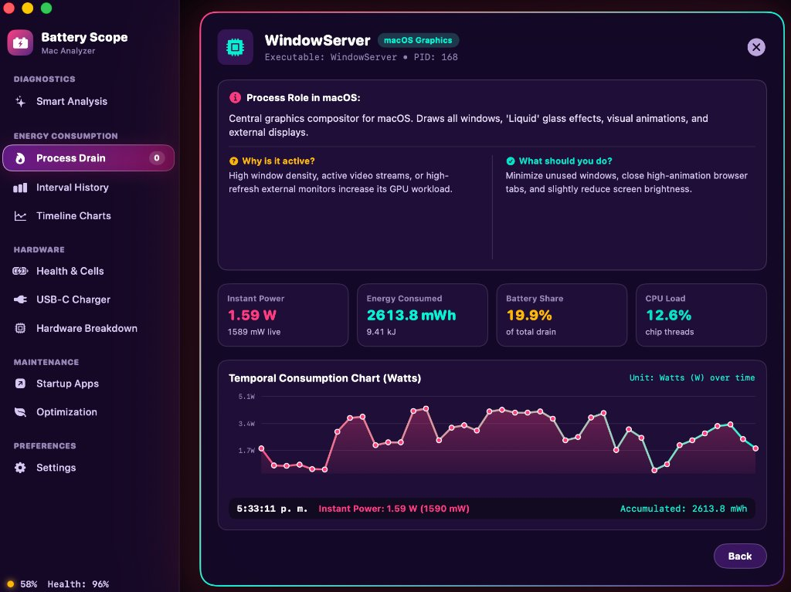
</p>

- ℹ️ **Process Role in macOS**: Explains what the daemon actually does (e.g. `WindowServer` compositing, `fileproviderd` syncing, `siriactionsd` background requests).
- ❓ **Why is it active?**: Automatically pinpoints the triggering cause (high window density, video streams, or external displays).
- 💡 **What should you do?**: Concrete, non-destructive recommendations to immediately reduce power consumption and reclaim hours of battery life.
- 📊 **Real-Time Telemetry Curve**: Live wattage trend, cumulative mWh drained, CPU thread workload, and percentage share of total drain.

---

### 🔍 Power Diagnostics & Timeline

| 🔥 Process Drain & Telemetry | 📈 Interval History & DarkWake |
| :---: | :---: |
| 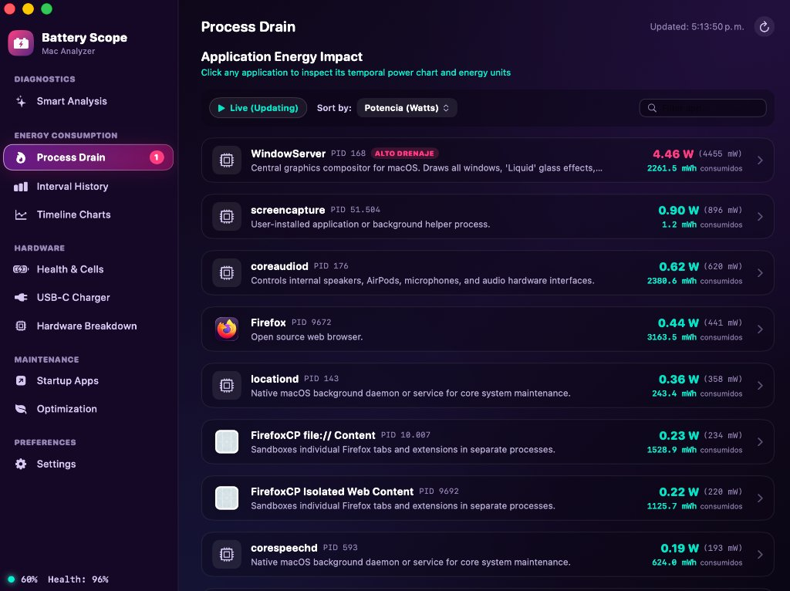 | 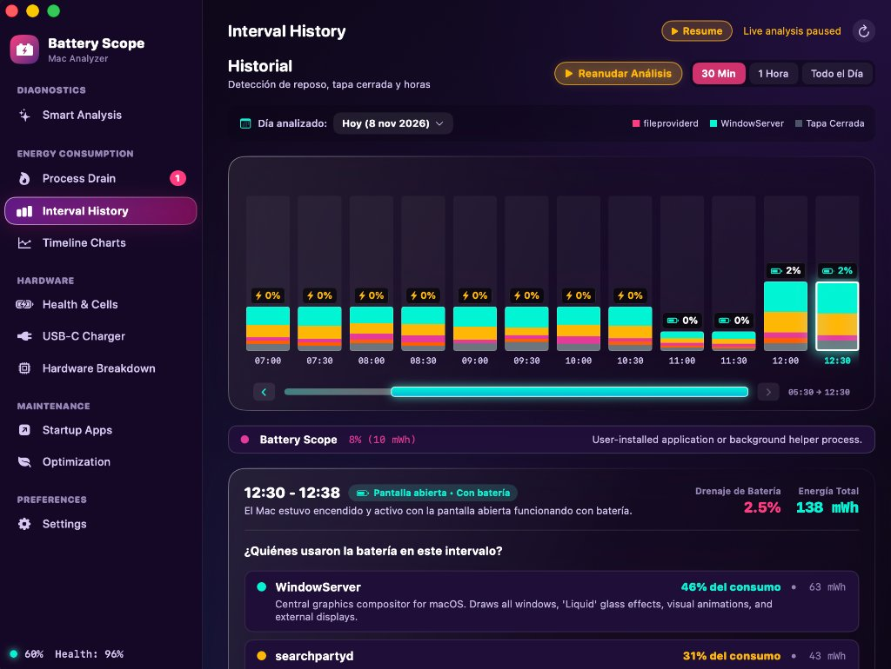 |
| *Real-time mWh, wattage curves & background service explanations* | *30-min block telemetry & background lid-closed power drains* |

| 📉 Timeline Consumption Charts | 🔋 3-Cell Hardware Health & Telemetry |
| :---: | :---: |
| 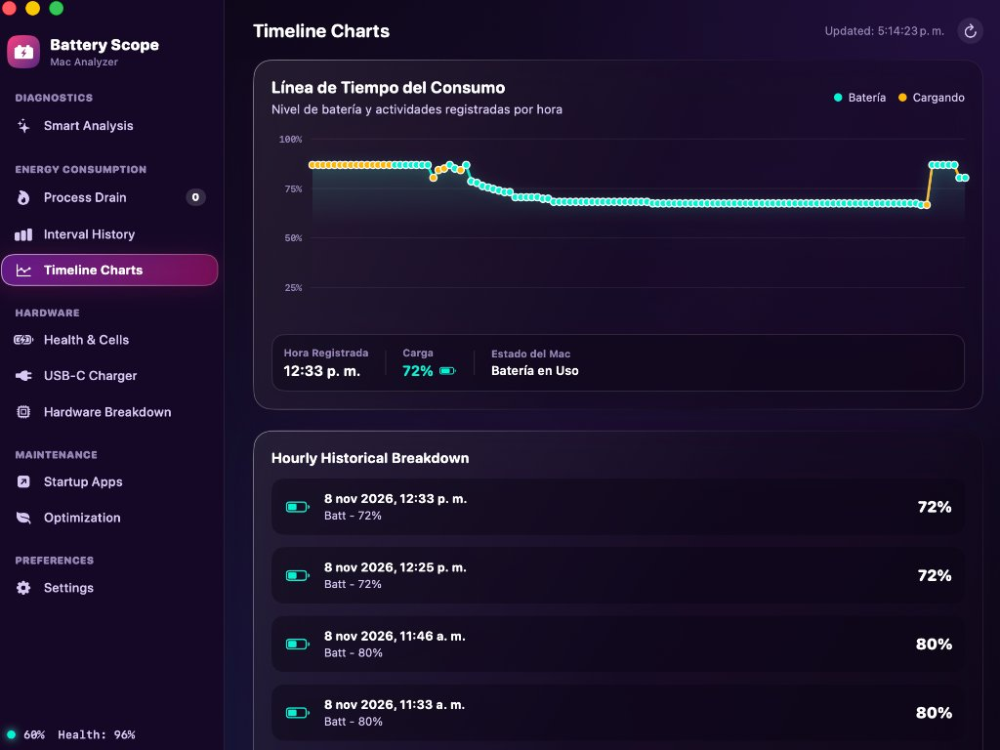 | 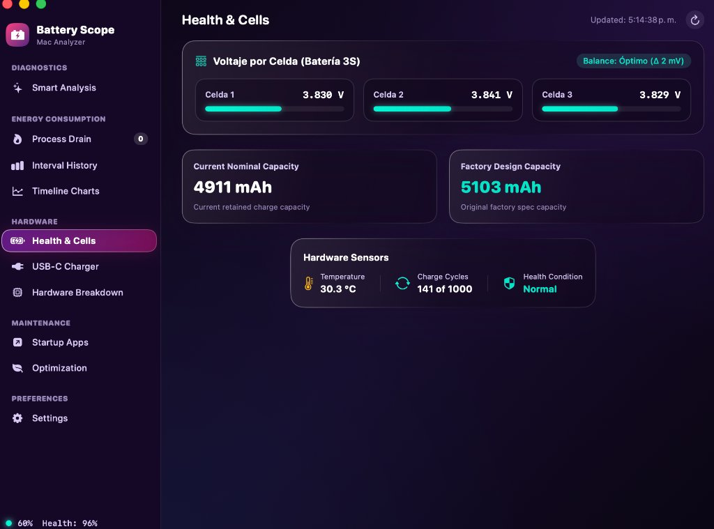 |
| *Historical timeline tracing battery and charging events* | *Live 3-cell voltage balancing, temperature sensor & cycle capacity* |

---

### 🔌 Hardware Inspection & Power Delivery

| ⚡ USB-C Charger & Power Delivery | 🖥️ Hardware Subsystems Breakdown |
| :---: | :---: |
| 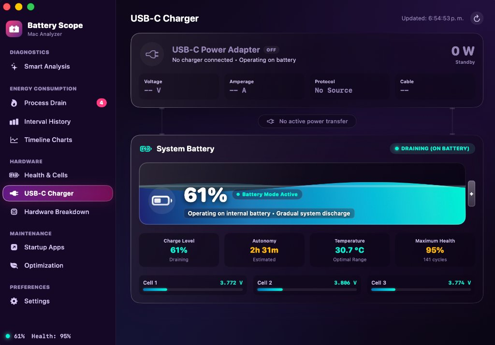 | 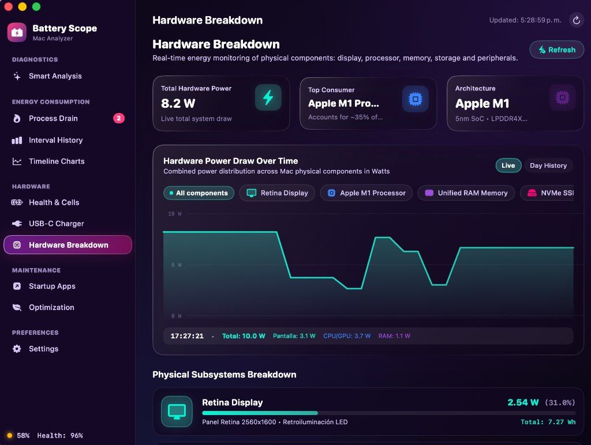 |
| *Negotiated PD wattage, adapter voltage, amperage & cable health* | *Real-time energy draw per component: SoC, Retina Display, RAM, SSD* |

---

### 🛠️ Maintenance, Startup & Preferences

| 🚀 Startup Apps Audit (Login Items) | 🛑 Smart Process Freeze & Optimization |
| :---: | :---: |
| 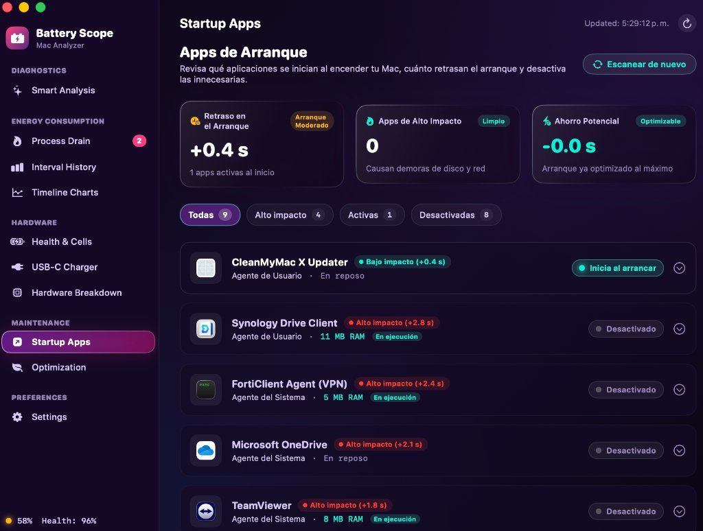 | 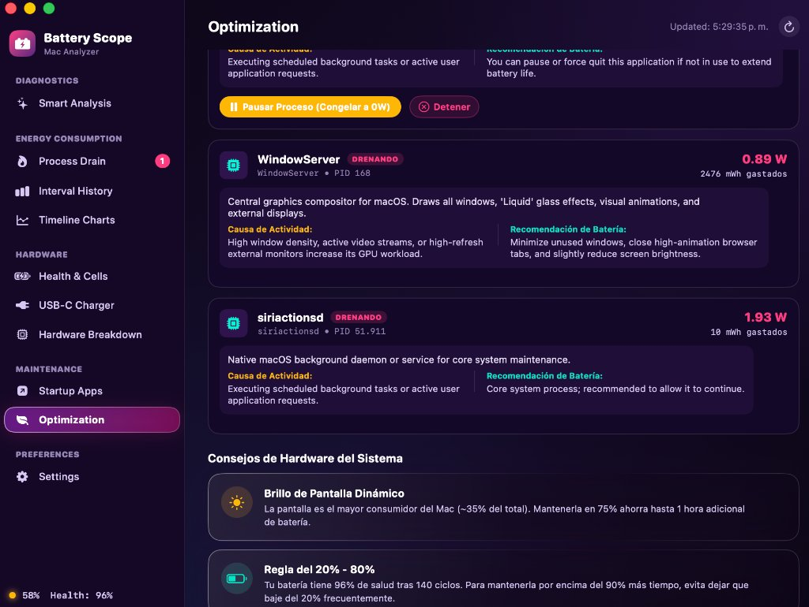 |
| *Audit background launch agents and manage boot delay impact* | *SIGSTOP freeze heavy sync hogs without quitting; display brightness tips* |

### 🌐 Multi-Language Settings
<p align="center">
  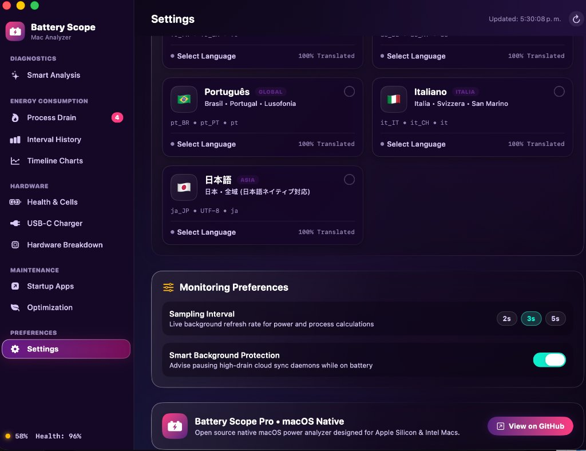
  <br>
  <i>Instant live language switching across 7 native languages with interactive flag cards</i>
</p>

---

## ✨ Features

- **🧠 Automated Intelligent Recommendations**:
  - Automatically identifies why background processes consume energy and provides specific, actionable battery-saving guidance for 30+ macOS daemons.
- **🔋 Real-Time Smart Battery Telemetry**:
  - Live wattage (W), voltage (V), and amperage (A) monitoring.
  - Individual 3-cell voltage balance visualizer.
  - Cycle count, retained design capacity, and health condition.
- **⚡ USB-C Charger & Power Delivery Inspector**:
  - Live negotiated wattage, voltage, amperage, and cable condition.
- **📊 Temporal Consumption & Interval History**:
  - Interactive block bar charts for hourly / 30-min drain history.
  - DarkWake / Lid Closed background power tracking.
- **🔥 Process Drain & Energy Hogs**:
  - Process power consumption rating, CPU thread usage, and milliwatt (mW) metrics.
  - Temporal consumption charts per process.
  - Built-in explanation database for 30+ system daemons and user apps.
- **🛑 Smart Process Control & SIGSTOP/SIGCONT Pausing**:
  - Temporarily pause heavy cloud sync daemons (`Google Drive`, `Synology Drive`, `fileproviderd`) while on battery without quitting them.
- **🚀 Startup Apps Audit**:
  - Review login items, launch agents, and their boot delay impact.
- **🖥️ Hardware Subsystems Breakdown**:
  - Live power breakdown across physical components: Retina Display, Apple M-Series SoC, Unified RAM, NVMe SSD, Audio, and Peripherals.
- **🌐 7 Native Languages Built-in**:
  - 🇺🇸 English *(Default on first launch)*
  - 🇪🇸 Español
  - 🇫🇷 Français
  - 🇩🇪 Deutsch
  - 🇧🇷 Português
  - 🇮🇹 Italiano
  - 🇯🇵 日本語
  - Seamless real-time switching without app restart via interactive language cards in Settings.
- **🧭 Liquid Glass Design**:
  - Modern, crystal dark mode interface with responsive animations and Menu Bar status item.

---

## 🛠️ System Requirements

- **Mac hardware**: MacBook Air, MacBook Pro, Mac mini, Mac Studio, iMac, or Mac Pro.
- **Chip**: Apple Silicon (M1, M2, M3, M4) or Intel Core (x86_64).
- **Operating System**: macOS 13.0 (Ventura), macOS 14.0 (Sonoma), or macOS 15.0+ (Sequoia).

---

## 🚀 Build from Source

You can also build the application directly with Xcode Command Line Tools:

```bash
git clone https://github.com/aldobm/BatteryScope.git
cd BatteryScope
chmod +x build.sh
./build.sh
```

The script compiles the native Swift application, signs it, and installs it to:
```
~/Applications/BatteryScope.app
```

---

## 📂 Project Architecture

```
BatteryScope/
├── AppIcon.icns                # Native macOS icon bundle
├── AppIcon.png                 # App icon image
├── build.sh                    # Build and compilation script
├── create_dmg.sh               # DMG disk image packager
├── publish_release.sh          # Automated GitHub Release publisher
├── .github/workflows/          # GitHub Actions CI/CD workflows
├── docs/screenshots/           # Screenshots and interface assets
├── README.md                   # Project documentation in English
├── README.es.md                # Project documentation in Spanish
└── src/
    ├── main.swift              # App entry point
    ├── AppDelegate.swift       # NSApplicationDelegate & MenuBar popover controller
    ├── MainView.swift          # Main split navigation canvas & tabs
    ├── MenuBarView.swift       # Menu bar quick status popup
    ├── BatteryService.swift    # IOKit & IOPS battery power service
    ├── ProcessDatabase.swift   # Explanations & macOS process database
    ├── LocalizationManager.swift # 7-language reactive localization manager
    ├── SettingsView.swift      # Preferences & language card selector
    ├── HardwareBreakdownService.swift # Component energy distribution model
    ├── HardwareBreakdownView.swift    # Hardware monitoring UI
    ├── StartupAppsService.swift       # Login items & launch agents analyzer
    ├── StartupAppsView.swift          # Startup apps management UI
    ├── TimelineAndEnergyViews.swift   # Temporal charts & interval history
    ├── SmartSyncAdvisor.swift         # Developer cloud sync optimizer
    ├── LiquidTheme.swift              # Design tokens & color palettes
    └── LiquidComponents.swift         # Custom SwiftUI cards, pills, buttons
```

---

## 📄 License

This project is licensed under the MIT License — see the [LICENSE](LICENSE) file for details.
